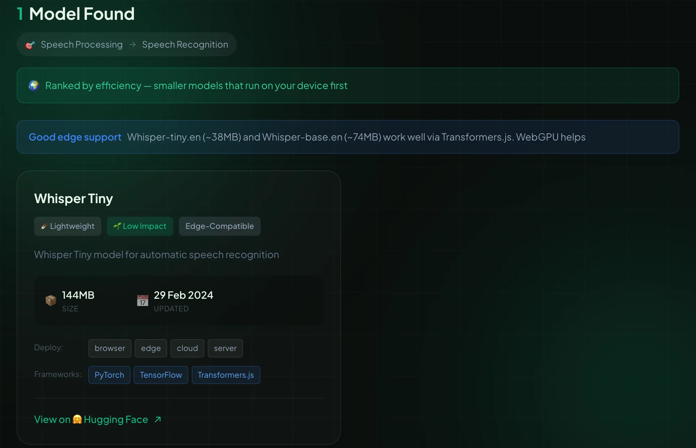

# AI Model Advisor

Find AI models you can run in the browser, on mobile or at the edge, with no server required. Pick a task and get models ranked smallest first, with an estimate of their environmental impact.

**[Try it →](https://ismaelmartinez.github.io/ai-model-advisor)**



## Example

Choose Speech Processing, Speech Recognition and "Browser" to see the Whisper and wav2vec models that can run on-device, smallest first. Or open "Describe your task" and type "transcribe audio recordings of meetings into text" and the form fills itself in.

Every search has a shareable URL:

```
https://ismaelmartinez.github.io/ai-model-advisor/?category=speech_processing&task=speech_recognition&deploy=browser
```

`category` and `task` use the keys from `src/lib/data/tasks.json`; `deploy` is optional (`browser`, `edge` or `cloud`).

## How it works

- Runs entirely in the browser; there is no backend.
- Models are ranked by size tier, then size. Tier and the environmental score come from the model's size (see [environmental methodology](docs/environmental-methodology.md)).
- "Describe your task" uses MiniLM embeddings (about 23 MB, downloaded only when you open it and cached afterwards), with keyword matching until they are ready.
- It is a PWA: installable, and works offline after the first visit.

## Development

```bash
npm install
npm run dev      # dev server
npm test         # run the tests
npm run build    # production build into dist/
```

Node 22 is required (`.nvmrc`).

## Adding a model

The data is a flat list in `src/lib/data/models.json`, validated by `src/lib/data/models.schema.json` when you run `npm test`.

1. Add an entry with the model's Hugging Face id, its size in MB, the tasks it serves and its deployment options.
2. Run `npm test`.
3. Open a pull request.

The full field reference and how the weekly updater works are in [docs/model-data.md](docs/model-data.md). The model list is also meant to be reusable: `models.json` and its schema are plain JSON.

## Deployment

Pushing to `main` deploys to GitHub Pages. To deploy elsewhere, change `paths.base` in `vite.config.js` (production builds use `/ai-model-advisor`; set it to `''` for a root deployment), run `npm run build` and publish `dist/`.

## More

[ROADMAP.md](ROADMAP.md) has the plan and vision, [docs/adrs](docs/adrs) the architecture decisions, and [CONTRIBUTING.md](CONTRIBUTING.md) how to contribute.

## License

MIT
